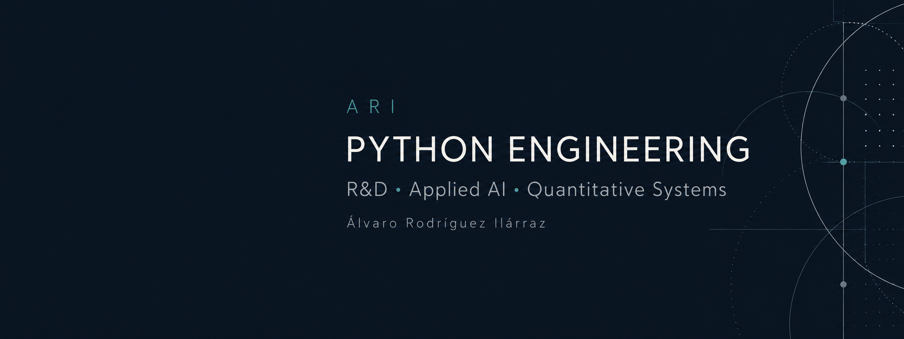

# Álvaro Rodríguez ilárraz

**Python Software Engineer · R&D · Applied AI & Quantitative Systems**

I build software to investigate markets, work with data, and turn ideas into tools people can use. My work connects Python engineering, reproducible research, and applied machine learning: from data pipelines and APIs to evaluation frameworks, reports, and dashboards.

My background spans software development, quantitative research, and enterprise systems. I enjoy the work between an interesting idea and a dependable implementation: defining inputs, checking assumptions, building the tooling, and making the results understandable.

[Portfolio & demos](https://alvaro-portfolio-mu.vercel.app/) · [LinkedIn](https://www.linkedin.com/in/alvarorodriguezilarraz/)

**Open to remote Python software engineering and R&D opportunities worldwide.** Based in Madrid, Spain.

## What I build

- **Data infrastructure:** ingestion, normalization, storage, quality checks, and provenance for market datasets.
- **Research software:** repeatable experiments, causal evaluation, statistical diagnostics, and traceable artifacts.
- **Applied AI workflows:** structured proposals, explicit validation boundaries, and controlled execution.
- **Tools people can inspect:** APIs, dashboards, reports, and web experiences that make technical work accessible.

Financial markets are a recurring application domain in my projects. The engineering problems behind them — unreliable inputs, uncertain models, reproducibility, and clear interfaces — shape how I approach software more broadly.

## Selected projects

### [Atlas Market Data](https://github.com/alvcid/atlas-market-data)

**Python · APIs · Parquet · DuckDB · Data quality**

A market-data engineering project covering two historical-data pipelines built around EODHD. It addresses the practical work behind research datasets: resumable ingestion, normalization, split adjustments, missing observations, storage, and quality reporting.

The public repository contains packaged code, tests, documentation, and offline demonstrations. Its synthetic examples let a reviewer inspect the transformations without downloading licensed market data or supplying credentials.

<strong>Engineering decisions and what you can reproduce</strong>

- Preserve original inputs while applying explicit transformations and split adjustments.
- Track provenance through manifests and hashes, and expose data through Parquet and SQL views.
- Distinguish the catalog used to store histories from the point-in-time eligibility rules required by a backtest.
- Demonstrate normalization, aggregation, gap handling, and download planning with synthetic inputs.
- Document remaining coverage and eligibility limitations alongside the implementation.

The offline demos exercise selected workflows; they do not reproduce or certify the complete historical archive.

[Code & offline demos](https://github.com/alvcid/atlas-market-data) · [Data limitations](https://github.com/alvcid/atlas-market-data/blob/main/docs/POINT_IN_TIME.md)

### [AlphaFabric](https://github.com/alvcid/AlphaFabric-Research)

**Python · Pydantic · Causal DSL · Statistical evaluation · Docker**

A quantitative research framework built around a separation of responsibilities: generative components propose candidates, while deterministic code controls admissible expressions, data access, evaluation, and the evidence trail.

The public edition runs offline on seeded synthetic data. A fixed typed proposal replaces the private model adapter, making the evaluation workflow inspectable without exposing private prompts, datasets, or strategy logic.

<strong>Contracts, reproducibility, and execution boundaries</strong>

- Validate proposals with strict schemas and a constrained expression language instead of executing arbitrary generated Python.
- Separate candidate selection from subsequent holdout evaluation.
- Include bootstrap diagnostics, multiple-testing correction, perturbation checks, and simplified cost diagnostics.
- Identify artifacts by content hashes and record operations in an idempotent, append-only ledger.
- Constrain optional Docker execution with non-root users, disabled networking, read-only filesystems, and allowlisted mounts.

The demo contains a deliberately embedded relationship. Reproducing it verifies the software workflow; it does not establish market predictability or trading profitability.

[Code & quick start](https://github.com/alvcid/AlphaFabric-Research) · [Architecture](https://github.com/alvcid/AlphaFabric-Research/blob/main/docs/architecture.md)

### [RegimeGate](https://github.com/alvcid/regimegate)

**Python · Time series · Bayesian modeling · Portfolio risk**

A research framework testing whether market-regime information adds value to an existing portfolio of trading systems. It combines causal Hidden Markov Model filtering, Bayesian estimates of system behaviour, and allocation that accounts for redundant systems and overlapping positions.

The repository includes a synthetic demo, implementation details, and a frozen evidence protocol. Its documented empirical verdict is **NO-GO pending an untouched external cohort**.

<strong>Research questions and implementation choices</strong>

- Use closed observations and forward-filtered probabilities to preserve causality.
- Represent regimes as probability mixtures rather than treating uncertain states as hard labels.
- Partially pool sparse estimates and assess whether expected value exceeds costs.
- Account for correlation, near-duplicate systems, and existing exposure when allocating risk.
- Use placebos and temporal resampling to distinguish regime timing from selection of generally stronger systems.

Keeping the unsuccessful evidence gates visible is part of the project: useful research software must support decisions to stop as well as decisions to continue.

[Code & synthetic demo](https://github.com/alvcid/regimegate) · [Methodology](https://github.com/alvcid/regimegate/blob/main/docs/METHODOLOGY.md)

## Interfaces and demonstrations

- **[IsTradeable](https://istradeable-demo.vercel.app/)** — strategy-validation software for MetaTrader 5, with reports and a limited public demo.
- **[Órbita](https://alvaro-portfolio-mu.vercel.app/alpaca-grande)** — a portfolio dashboard and case study using Alpaca Paper, with account evolution and system monitoring. Displayed results are from paper trading.
- **[Web projects](https://alvaro-portfolio-mu.vercel.app/#proyectos)** — digital experiences including TRAMA and client websites, showing another side of my work: presentation, interaction, and usability.

My portfolio is evolving as I prepare additional projects for public review.

## How I approach engineering and research

1. **Start with the inputs.** Check provenance, missing data, temporal availability, and assumptions before adding model complexity.
2. **Make experiments repeatable.** Use explicit configurations, controlled inputs, tests, and traceable outputs.
3. **Separate exploration from evaluation.** Compare with simple baselines and keep selection decisions distinct from later validation.
4. **Preserve negative results.** Record failures and inconclusive findings so they inform the next investigation.
5. **Explain the boundaries.** State what a demo reproduces, what remains private, and which conclusions the evidence supports.

## Technical toolkit

| Area | Technologies and practices |
| --- | --- |
| Software | Python, SQL, C#, .NET, APIs, Git |
| Data engineering | pandas, NumPy, Parquet, DuckDB, ingestion and quality checks |
| Machine learning | scikit-learn, TensorFlow, time-series modeling |
| Research tooling | Pydantic, pytest, Docker, causal evaluation, statistical diagnostics |
| Interfaces | Streamlit, dashboards, reports, web applications |

## Professional background and learning

At **WADAX**, I developed and evaluated algorithmic trading strategies using Python and machine learning. At **TravelgateX**, I worked on software and API integrations using Python, C#, and Visual Basic .NET. Earlier roles at **Indra** and **everis** involved SAP systems, treasury processes, client requirements, and issue resolution.

I am studying **Computer Engineering at UNIR** and have completed **QuantInsti's Executive Programme in Algorithmic Trading**. My continued learning includes Python programming, machine learning, deep learning, and applied AI workflows.

<strong>Earlier concepts and learning repositories</strong>

These repositories provide context for earlier investigations and design ideas:

- [Alpha Evolution Lab — Concept Release](https://github.com/alvcid/Alpha-Evolution-Lab-Concept-Release)
- [Synthetic Market Engine — Concept Release](https://github.com/alvcid/Synthetic-Market-Engine-Concept-Release)
- [MLdP Pipeline — Concept Release](https://github.com/alvcid/MLdP-Pipeline-Concept-Release)

They are concept releases, distinct from the executable public editions featured above. Other repositories contain learning exercises and experiments in machine learning and deep learning; their individual documentation describes their scope.

## Let's connect

I am interested in teams building useful software around data, research, and applied AI, particularly where careful experimentation and maintainable systems matter.

**[Explore my portfolio](https://alvaro-portfolio-mu.vercel.app/) · [Connect on LinkedIn](https://www.linkedin.com/in/alvarorodriguezilarraz/)**
